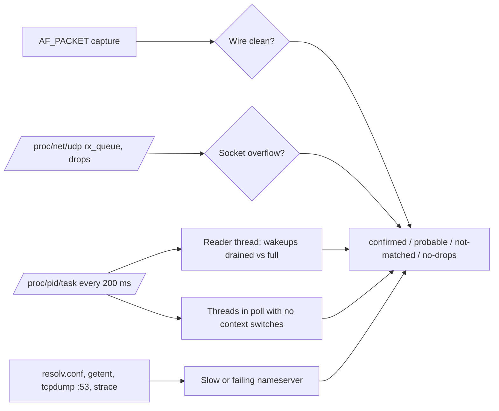

# mpegts-ingest-getaddrinfo-stall feature

Skill: [`mpegts-ingest-getaddrinfo-stall`](../../../.agents/skills/mpegts-ingest-getaddrinfo-stall/SKILL.md).
Workflow: [mpegts-ingest-getaddrinfo-stall.md](../../../workflows/mpegts-ingest-getaddrinfo-stall.md).
Tool: [tools/mpegts-ingest-getaddrinfo-stall](../../../tools/mpegts-ingest-getaddrinfo-stall/README.md).
Behavior cases: [tests/scenarios/mpegts-ingest-getaddrinfo-stall.md](../../../tests/scenarios/mpegts-ingest-getaddrinfo-stall.md).

The ingest stall extension adds a second repository skill,
`mpegts-ingest-getaddrinfo-stall`. It diagnoses `mpeg2tscameraN` ingest threads
that stop reading their MPEG-TS inputs while a blocking `getaddrinfo()` waits on
a slow nameserver. It ships a read-only collector (`nimdiag collect`), a DNS
evidence script, and an offline analyzer in Rust and Python. Collection runs
only on explicit request and is never part of log analysis or workspace tests.

## Design

Nimble processes several MPEG-TS inputs in each `mpeg2tscameraN` thread. If an
input pulls from a host name, its lookup can call the synchronous glibc
resolver inside that thread's event loop. With a first nameserver that is slow
or silent, the thread waits in `poll()` for the resolver timeout, and UDP inputs
on the same thread overflow their socket buffers. Logs rarely show this,
because a slow lookup that succeeds logs nothing. The evidence comes from the
kernel, the threads, and DNS:

`nimdiag collect` is a static Rust binary that records wire, socket, and thread
data side by side. When a socket overflows, it saves an event with 200 ms thread
samples and a pcap. It also records Nimble's connected UDP sockets to port 53,
the resolver configuration, and a masked `nimble.conf`. It changes nothing on
the host. `collect_dns_evidence.sh` adds lookup timing and a port-53 capture,
and with consent an strace of only the threads found in `poll()`.

The analyzer exists twice, as `nimdiag analyze` and as a standard-library
Python script, with the same checks and the same JSON report, so users without
a Rust toolchain get the same result. The reader thread is the one whose
wakeups drop the most between seconds when the queue drains and seconds when
it is full. Correlation is not used, because it ignores scale and picked
unrelated threads with small in-phase variations. The per-second thread rollup
may trail socket counters by one record, so lags 0 and +1 are both tried.
Blocked threads come from the 200 ms event samples, or from per-second data
when no events exist. A verdict of `confirmed` requires DNS evidence; without
it the result is `probable` and the workflow asks for the DNS check.

Collection touches a live host as root, so it runs only on explicit request,
preferably by the operator. Remediation such as resolver order, resolver
timeouts, a local cache, or a Nimble restart where glibc predates automatic
`resolv.conf` reloads is proposed, never applied. Tests use synthetic fixtures
for both analyzers and an optional live lab in new network, PID, and mount
namespaces. There, a fake `nimble` calls the real glibc resolver against a
silent nameserver; real Nimble processes and the host resolver are not visible.

## Specification

1. Analysis of supplied material (nimdiag result directories, `/proc/net/udp`
   copies, DNS text, strace output, Nimble logs) only reads files. It may run
   on request at any time and on any machine.
2. `nimdiag collect`, `collect_dns_evidence.sh` and strace run on the Nimble host
   as root only on an explicit request. The workflow prefers giving the operator
   the commands. strace is used only with the operator's consent and traces only
   thread ids found in `poll()`/`ppoll()`, never the whole process with `-f`.
   Log analysis and workspace tests never run them.
3. `nimdiag collect` changes nothing in Nimble or the system. Besides wire,
   socket, thread and event data it records the number of Nimble's connected
   UDP sockets to port 53 per second, `/etc/resolv.conf`, the resolver setup
   (nsswitch `hosts`, glibc version), and `nimble.conf` with values of keys
   containing pass, key, token, secret, auth, login, user, uuid, license or
   cert, and keys `id`/`*_id`, masked. Its summary compares wire CC/RTP errors
   with socket drops instead of calling any CC error an upstream problem, and it
   ends with the analyzer's verdict for the run. `collect` is the default
   subcommand, so the earlier command line keeps working.
4. `nimdiag analyze` and `python/ingest_stall.py analyze` implement the same
   checks and produce JSON reports with identical structure and values (floats
   within 0.01) and identical text. The checks are socket overflow on a clean
   wire with a clean host, a stable drain period, the reader thread, threads
   blocked in `poll`/`ppoll` without context switches, resolver sockets in
   flight, nameserver health, lookup time, blocking resolver polls in strace,
   and the thread-to-pull-host map from the Nimble log.
5. Verdicts: `confirmed` needs socket overflow, a blocked reader, DNS evidence,
   and a stable period or stalls as long as the resolver timeout; `probable`
   lacks DNS evidence (or thread samples); `not-matched` gives the competing
   explanation; `no-drops` means no socket drops. Reports list inputs not
   provided.
6. Remediation (resolver order, `options timeout/attempts`, a local cache, a
   Nimble restart where glibc predates 2.26, more ingest threads as mitigation
   only) is proposed, never applied. Reports redact host names, addresses and
   URL tokens from user data. Archives and evidence stay out of the repository.
7. `tools/mpegts-ingest-getaddrinfo-stall/tests/run_tests.sh` runs the Rust unit
   tests, generates synthetic fixtures (documentation addresses and `.example`
   names only) for six scenarios, checks the expected verdicts with both
   analyzers, and compares their output. `LIVE=1` adds a root-only lab in new
   network, PID and mount namespaces. There, `nimdiag collect` and the DNS
   evidence script observe a fake `nimble` whose ingest thread calls the real
   glibc resolver against a silent nameserver. The lab must not see or touch a
   real Nimble process or the host resolver configuration.

## Acceptance checks

- The `mpegts-ingest-getaddrinfo-stall` skill passes the same frontmatter and
  symlink checks and links to its workflow; `AGENTS.md` routes ingest stall
  requests there.
- The ingest stall suite passes offline: Rust unit tests, expected verdicts for
  the blocked-resolver, no-DNS-evidence, per-second-only, slow-reader,
  upstream-loss and clean fixtures with both analyzers, and Python/Rust parity
  of JSON and text. With `LIVE=1`, the isolated lab reports `confirmed` for the
  input that shares a thread with the pull input and not for the other input.
  It flags the silent nameserver and finds a blocking resolver poll in strace,
  and the collected `nimble.conf` contains no unmasked credential-like value.
- A log-analysis or test request does not run the collectors. An ingest stall
  request without DNS evidence ends in `probable` and asks for the DNS check.

## Plan

Add a repository skill for `mpeg2tscameraN` ingest threads that stop reading
their inputs while a blocking `getaddrinfo()` waits on a slow nameserver. The
collector and analysis come from a support case; all repository data is
synthetic.

- [x] Add `tools/mpegts-ingest-getaddrinfo-stall`: nimdiag (Rust) with `collect`,
  `analyze` and `udp`, the Python analyzer, `collect_dns_evidence.sh`, and the
  testkit.
- [x] Fix the collector: mask `uuid`/`id`-like keys in `nimble.conf`, compare wire
  errors with socket drops, record resolver sockets and setup, and check the
  Nimble process first when mapping socket owners.
- [x] Detect the reader by the wakeup drop between drained and full seconds with
  a one-record lag tolerance, instead of correlation.
- [x] Add synthetic fixtures, expected verdicts, Python/Rust parity checks, and
  the isolated live lab.
- [x] Add the workflow, canonical skill and Claude symlink, the feature rows
  in `AGENTS.md` and `README.md`, this document, behavior cases in
  `tests/scenarios/`, and `tests/test_feature_mpegts_ingest_getaddrinfo_stall.py`.
