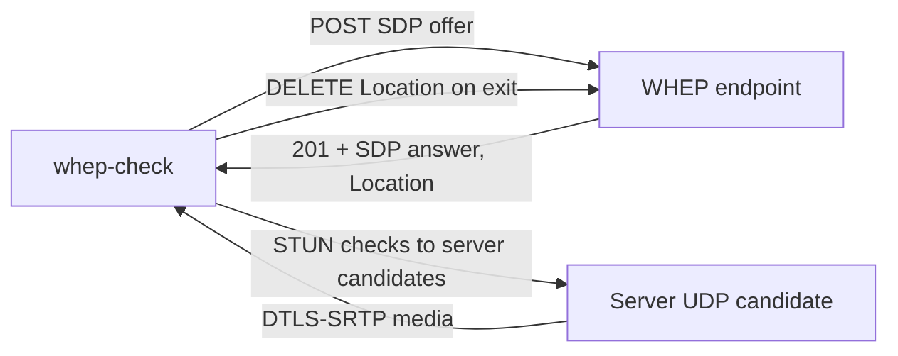
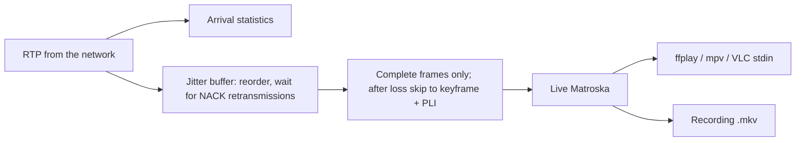

# whep-check feature

Skill: [`whep-check`](../../../.agents/skills/whep-check/SKILL.md).
Workflow: [check-whep.md](../../../workflows/check-whep.md).
Tool: [tools/whep-check](../../../tools/whep-check/README.md).
Behavior cases: [tests/scenarios/whep-check.md](../../../tests/scenarios/whep-check.md).

The WHEP playback extension adds a second repository skill, `whep-check`. It
is a Go WebRTC client and workflow that checks a user-supplied WHEP endpoint
by opening one bounded viewer session. It reports signaling, ICE/DTLS, and media
results, and it is never part of log analysis or workspace tests.

## Design

Log analysis can show that WHEP sessions were registered and later closed, but
the WebRTC media path is often decided outside the log. Typical causes are
unreachable ICE candidates, blocked UDP, or a missing media stream. The
`whep-check` client reproduces a player from the agent's host or the user's
machine and reports which stage failed.

The client is built with Go and Pion WebRTC. It offers receive-only H.264,
other default video codecs, and Opus. It prints the answer's ice-lite mode,
codecs, and candidates. It then follows ICE and DTLS state and logs the
selected candidate pair. On exit it deletes the WHEP resource. Exit codes
separate signaling (`2`), ICE/DTLS (`3`), and missing media (`4`) from success
(`0`).

Media analysis runs on packets as they arrive, before any buffering, so it
describes what the network delivered:

- Format: H.264 SPS/PPS (profile, level, resolution, VUI frame rate and colour,
  reordering) and the Opus table-of-contents byte, compared with the SDP
  `profile-level-id` and the H.264 level limits.
- Transport: lost, late (reordered or retransmitted), and duplicate packets per
  sequence number, plus NACK and PLI requests counted by an RTCP interceptor
  placed before Pion's NACK generator.
- Frames: frames per second, keyframes counted once per frame, and the GOP. A
  keyframe is requested with PLI only until the first one arrives.
- Timing: gaps between frame arrivals are compared with the RTP time that
  passed. Arrival gaps with continuing timestamps mean delayed delivery; gaps
  in both mean the source sent nothing. RTP regularity is measured against the
  dominant frame step, so lost frames do not count as irregular.

Optional playback and recording share one path: a jitter buffer ordered by
sequence number gives up a missing packet once the packet after it has waited
for the buffer delay. Complete frames are muxed into live Matroska with
timestamps anchored at each track's first frame arrival. The stream header is
written at the first video keyframe, after the expected audio track starts or
a short timeout. A pipe replaces the former local UDP/SDP forwarding, which
could drop packets on bursts and passed reordered packets to the player.

The check sends network traffic, unlike log analysis. It runs only on an
explicit request for a user-supplied URL and is bounded in duration. It never
controls or reconfigures Nimble. Firewall and `whep_config.json` changes are
proposals. Observe-mode tests keep their no-probe rule; the client's own tests
use an in-process ice-lite WHEP server and never contact real endpoints. The
workflow requires a client-side UDP check, with a STUN-derived server-reflexive
candidate, before an ICE failure is attributed to the server.

## Specification

1. Run `tools/whep-check` only on an explicit request to check WHEP playback,
   with a URL the user supplied. Do not derive endpoints from logs or
   configuration. Never run it during log analysis or workspace/commit tests.
2. Build with Go 1.22 or later. When Go is unavailable, explain the build steps
   for another machine instead of substituting another network tool.
3. Each run performs one WHEP `POST` with a receive-only SDP offer, connects,
   receives media for a bounded duration (default 20 seconds) or until
   interrupted, and sends `DELETE` to the returned `Location` on exit. ICE/DTLS
   has a bounded timeout (default 15 seconds). Repeat runs only on request or
   to distinguish hypotheses.
4. Output carries UTC timestamps and reports the HTTP status, timing, ice-lite
   mode, negotiated codecs, server candidates, ICE/DTLS states, and selected
   candidate pair. Exit codes: `0` media received, `1` usage, `2` signaling,
   `3` ICE/DTLS, `4` connected without media. A private server candidate
   address produces a warning.
5. After media starts, the client prints the video format from the H.264
   SPS/PPS and the audio format from the Opus TOC byte. It notes a mismatch
   between the SDP `profile-level-id` and the SPS, warns when resolution and
   frame rate exceed the signalled level, and reports format changes.
6. Statistics are taken on arrival, before buffering, per interval and for the
   session: bitrate, lost, late, and duplicate packets, NACKed sequence numbers
   and PLIs sent, frames, keyframes counted once per frame, GOP, largest frame
   gap, and maximum arrival delay. Gaps above 250 ms are logged and classified
   as delayed delivery (RTP time advanced much less than wall time) or a source
   pause. The final summary gives the RTP frame-step grid regularity and a
   timing verdict. A keyframe is requested only until the first one arrives.
7. `-play` and `-record` share a jitter buffer (`-buffer`, default 300 ms) and
   write only complete frames as live Matroska. After an unrecoverable loss,
   video resumes at the next keyframe and one PLI is sent. `-play` starts the
   player with the stream on standard input, ends the check when the player
   exits, and requires a graphical session; `-player ""` writes the stream to
   stdout and logs to stderr. `-record` writes
   `<dir>/whep-check-<UTC time>.mkv`. `-stun` adds a server-reflexive candidate
   to verify that outbound UDP leaves the client network.
8. Interpretation separates signaling, transport, and media stages. Before
   attributing an ICE failure to the server, check client-side UDP. Explain
   that a plain `GET` of a WHEP URL is not a WHEP request. Firewall and Nimble
   `whep_config.json` changes remain proposals for the user.
9. Redact URL signatures and tokens in reports; pass bearer tokens through
   `-token`. State what was not verified, such as visual quality without
   playback, other client networks, and missing server logs.
10. The client's Go tests use an in-process ice-lite WHEP server with synthetic
    RTP. They verify success with media and resource deletion, a signaling
    failure, and an unreachable-candidate ICE failure without contacting real
    endpoints. An optional end-to-end test uses real H.264 and Opus made by a
    local `ffmpeg` and is skipped when `ffmpeg` is not installed.

## Acceptance checks

- The `whep-check` skill passes the same frontmatter and symlink checks and
  links to `workflows/check-whep.md`. `AGENTS.md` routes WHEP checks there.
- `go vet ./...` and `go test ./...` pass in `tools/whep-check` without network
  access to real endpoints. The tests cover media receipt with `DELETE` and a
  decodable Matroska structure, signaling failure, ICE timeout, piping to a
  player that exits, SPS/PPS/Opus parsing and level checks, loss, late and
  duplicate accounting, keyframe and GOP counting, gap classification, the
  jitter buffer, and skipping to a keyframe after loss. When `ffmpeg` is
  installed, an end-to-end test sends real H.264 with a resolution switch and
  Opus with reordering, an unrecoverable loss, and a delivery stall, and ffmpeg
  decodes both the recording and the live player stream, read with the same
  input options as ffplay, without errors.
- A log-analysis or test request does not run the WHEP client. A WHEP check
  request without a URL asks for one; a supplied URL is checked once and
  reported by stage with redacted secrets.

## Plan

Add a second repository skill for checking WebRTC WHEP playback from a
user-supplied endpoint. A Go client (Pion WebRTC) performs the WHEP exchange,
reports signaling, ICE/DTLS, and media stages, and optionally plays or records
the stream. The check is explicit and bounded, and it is separate from log
analysis and workspace tests.

- [x] Add `tools/whep-check` with offline Go tests against an in-process
  ice-lite WHEP server (media plus `DELETE`, signaling failure, ICE timeout).
- [x] Add `workflows/check-whep.md`, the canonical `whep-check` skill, and its
  Claude directory symlink; route WHEP checks from `AGENTS.md`.
- [x] Update the README, design, specification, test workflow, behavior
  scenarios, and repository tests.
- [x] Run Go vet/tests, the Python suite, the map check, and diff checks.
- [x] Report media format (SPS/PPS, Opus TOC) with SDP and level checks.
- [x] Count lost, late, and duplicate packets, NACKs and PLIs, keyframes per
  frame and GOP; classify delivery gaps against RTP time.
- [x] Replace UDP/SDP forwarding with a jitter buffer, complete-frame assembly,
  and live Matroska for `-play` (player stdin) and `-record` (.mkv).
- [x] Add unit tests and an optional ffmpeg end-to-end test with impairments.
